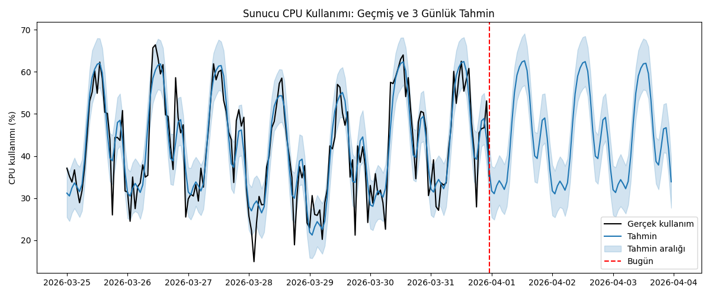

# Cloud Usage Forecasting

Forecasting hourly server CPU usage with Prophet, a first step toward predicting cloud costs.



## Features

- **Synthetic data generator** (`veri_olustur.py`): creates 90 days of hourly CPU usage (2,160 rows) with a realistic shape: a daily cycle with an evening peak, lower weekend traffic, a slow growth trend and random noise. Uses a fixed random seed so results are reproducible.
- **Forecast model** (`ilk_tahmin.py`): trains a Prophet model with daily and weekly seasonality and forecasts the next 72 hours (3 days).
- **Uncertainty intervals**: prints the forecast with lower and upper bounds (`yhat_lower`, `yhat_upper`).
- **Chart**: plots the last 7 days of actual usage against the forecast and its confidence band, and saves it as `ilk_tahmin.png`.

The code comments and chart labels are in Turkish.

## Tech stack

- Python
- [Prophet](https://facebook.github.io/prophet/) for time-series forecasting
- pandas and NumPy for data generation and handling
- Matplotlib for plotting

## How to run

```bash
git clone https://github.com/aycanihan/cloud-project.git
cd cloud-project
python -m venv .venv
# Windows: .venv\Scripts\activate    macOS/Linux: source .venv/bin/activate
pip install prophet pandas numpy matplotlib

python veri_olustur.py   # generates sunucu_verisi.csv
python ilk_tahmin.py     # trains the model, prints the forecast, saves ilk_tahmin.png
```

## Project structure

```
veri_olustur.py   Generates synthetic hourly CPU usage data (sunucu_verisi.csv)
ilk_tahmin.py     Trains Prophet and forecasts the next 3 days
ilk_tahmin.png    Output chart from the last run
```

## What I learned

- How to **simulate realistic time-series data** by combining seasonality, trend and noise, so a model can be built before real data is available.
- The basics of **Prophet**: the `ds` / `y` input format, daily and weekly seasonality, and `make_future_dataframe` for forecasting ahead.
- Reading **forecast uncertainty**, not just the point prediction, which matters when the forecast is used for capacity or cost planning.
